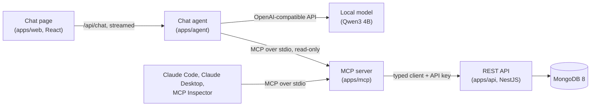

# Northwind MCP

The classic **Northwind Traders** database rebuilt as a modern REST/OpenAPI API on MongoDB +
NestJS, wrapped in an **MCP server** so AI assistants can work with it, and a chat page where a
**small local model** answers questions about the business through that server.



## What it shows

- **MCP server design** ([apps/mcp](apps/mcp/README.md)): 20 task-shaped tools instead of one
  per endpoint, a guide resource, 3 prompts with autocomplete, output schemas, and order writes
  behind one switch, with destructive tools marked and confirmed. Background and the design
  reasoning: [docs/mcp-primer.md](docs/mcp-primer.md).
- **Tools that small models can use:** lenient arguments behind strict, llama.cpp-safe schemas;
  references by code or name with close matches for typos; named periods instead of date
  arithmetic; results that carry the next step. Measured, not assumed:
  [docs/benchmark.md](docs/benchmark.md) takes a 4B model from 6.7 to about 8 of 9.
- **An API built for a model as the reader:** readable codes (`ALFKI`, `ORD-10248`), money as
  decimal strings, Problem Details errors with field paths, task-shaped analytics, and an
  OpenAPI spec with a contract test, from which the MCP server's client is generated.
- **A safe chat agent** ([apps/agent](apps/agent)): an MCP host with a streaming tool loop, the
  MCP server forced read-only, a strict Content Security Policy, and each answer showing the
  tool calls behind it.
- **Engineering around it:** a Turborepo monorepo (TypeScript, pnpm), Mongoose schemas with
  copied references, a seed that shifts the classic data to the present, over 400 unit and
  end-to-end tests (in-memory MongoDB, in-memory MCP clients, a scripted model), Docker images
  and Compose profiles, and a smoke test of the whole stack.

## Install the chat on a new Mac

For a Mac that only needs to **run** the chat. No Node or developer tools are needed:
everything builds inside Docker.

**1. Check the hardware.**

|           | Minimum                           | Recommended                             |
| --------- | --------------------------------- | --------------------------------------- |
| Mac       | Apple silicon (M1 or later)       | the same                                |
| Memory    | 8 GB (tight; close other apps)    | 16 GB or more                           |
| Free disk | 10 GB                             | 15 GB or more (images, model, database) |
| macOS     | a version Docker Desktop supports | the latest                              |

**2. Install Docker Desktop** for Apple silicon from
https://www.docker.com/products/docker-desktop/, open it once and finish its first-run screens.
Version 4.40 or later is needed (it includes Compose and Model Runner).

**3. Get the project.**

```sh
git clone https://github.com/wbarahona/northwind-mcp.git ~/northwind-chat
cd ~/northwind-chat
```

**4. Check the Mac, then set everything up.**

```sh
bash scripts/doctor.sh     # ✓ fine · ! worth knowing · ✗ fix this first
bash scripts/setup.sh      # 5–20 minutes the first time, mostly the model download
```

Setup writes `.env` with a new random API key, turns on Docker Model Runner (a Docker Desktop
setting), downloads the model (Qwen3 4B, about 2.5 GB) and the base images, builds the stack,
starts it, loads the Northwind data and prints the chat's address. Everything it downloads
stays on this Mac. It is safe to run again: it keeps `.env` and never reloads a database that
already has data. `bash scripts/setup.sh --dry-run` shows the steps without doing them.

**5. Give the model room (16 GB Macs).** The model runs outside Docker's virtual machine, so
the VM needs less: Docker Desktop → Settings → Resources → Memory, about 3 GB, then Apply &
restart. (`doctor.sh` warns when it's set higher.)

**6. Open the chat** at http://localhost:5173. The status should say "Local model ready"; the
first answer takes longer while the model loads.

**Share it on your network.** Add `AGENT_BIND=0.0.0.0` to `.env`, then
`docker compose --profile stack up -d --wait`. Others on the same network open
`http://<this-mac>.local:5173` (setup prints the name; it is also in System Settings → General
→ Sharing). macOS may ask whether to allow incoming connections for Docker: allow it. **There
is no login**: anyone on the network can ask questions. The data is read-only, but share only
on a network you trust.

**Day to day.**

| To                           | Run                                                                                                               |
| ---------------------------- | ----------------------------------------------------------------------------------------------------------------- |
| Stop the chat (data stays)   | `docker compose --profile '*' down`                                                                               |
| Start it again               | `docker compose --profile stack up -d --wait`                                                                     |
| See what the agent is doing  | `docker compose logs -f agent`                                                                                    |
| Reset the Northwind data     | `docker compose run --rm seed`                                                                                    |
| Update to the latest version | `git pull && bash scripts/setup.sh`                                                                               |
| Remove everything            | `docker compose --profile '*' down -v` (deletes the data), then `docker model rm hf.co/Qwen/Qwen3-4B-GGUF:Q4_K_M` |

**If something goes wrong.**

- **"Model server offline" in the chat:** Docker Model Runner is off or still loading. Run
  `docker model status`; setup turns it on.
- **A base image won't download (429 Too Many Requests):** Docker Hub limits downloads on some
  networks. Set `NODE_IMAGE` and `MONGO_IMAGE` in `.env` to another registry (examples in
  `.env.example`) and run setup again.
- **"Port … is in use":** something else (often a developer's `pnpm dev`) holds 5173, 3000 or 27017. Stop it, or move the stack with `AGENT_PORT` / `API_PORT` / `MONGO_PORT` in `.env`.
- **Slow answers:** the first one loads the model (10–30 s). After that, expect a few seconds
  to half a minute per answer on a base Apple silicon laptop, longer for questions that need
  several look-ups.

## Requirements (development)

- Node 24 (`nvm use` — pinned in `.nvmrc`)
- pnpm via corepack (`corepack enable`; version pinned in `package.json`)
- Docker Desktop (running)

## Getting started

```sh
nvm use
corepack enable
pnpm install
cp .env.example .env
pnpm db:up          # MongoDB 8, single-node replica set on localhost:27017
pnpm seed           # load classic Northwind, dates shifted to the present (idempotent)
```

Connect with Compass or mongosh: `mongodb://localhost:27017/northwind?replicaSet=rs0`

## Using the API

```sh
pnpm dev            # http://localhost:3000
```

- **Docs:** http://localhost:3000/docs (Swagger UI; click _Authorize_ and enter a key from `API_KEYS`). The raw spec is at `/openapi.json` and is committed as [`apps/api/openapi.json`](apps/api/openapi.json).
- **Auth:** send `x-api-key` on every request except `/health`.

```sh
curl -H 'x-api-key: dev-key-change-me' localhost:3000/v1/customers/ALFKI
curl -H 'x-api-key: dev-key-change-me' 'localhost:3000/v1/orders?customerId=ALFKI&status=pending'
curl -H 'x-api-key: dev-key-change-me' 'localhost:3000/v1/analytics/top-customers?from=2026-07-01&to=2026-10-01&limit=5'
```

The conventions (ids and codes, money as decimal strings, pagination, Problem Details errors, date ranges) are described at the top of `/docs`.

## Run the whole stack in Docker

The API and the chat, built into images and run next to Mongo, with no Node needed on the
host for them:

On a new Mac, one command checks the machine, writes `.env` with a random API key, turns on
Docker Model Runner, downloads the model and images, builds, starts and seeds:
`bash scripts/setup.sh` (`--dry-run` shows the steps; `bash scripts/doctor.sh` only checks).
It needs only Docker Desktop, and it is safe to re-run. Day to day:

```sh
pnpm stack:up       # builds the images, starts mongo + api + agent, waits until healthy
pnpm stack:seed     # first time (or to reset): load classic Northwind
curl -H 'x-api-key: dev-key-change-me' localhost:3000/v1/orders/ORD-10248
open http://localhost:5173   # the chat
pnpm stack:down     # stop everything (the data stays in the Docker volume)
```

- The API container uses `API_KEYS` from `.env` (required) and listens on
  `127.0.0.1:3000`, like `pnpm dev`. So `.mcp.json`, Swagger and Compass work unchanged.
- **Run the stack or `pnpm dev`, not both**: they share ports 3000 and 5173 (starting the
  second one fails with "address already in use") and the same Mongo data. `API_PORT` and
  `AGENT_PORT` move the stack's ports if you need both.
- `pnpm stack:smoke` checks everything on a throwaway copy: its own Mongo, data and
  ports, removed afterwards. It covers health, auth, an order read, the MCP server placing
  and shipping an order through the container, and the chat agent (page, read-only tools,
  a clear error without a model).
- Settings (`API_PORT`, `MONGO_PORT`, `MONGO_DB`, `NODE_IMAGE`, `MONGO_IMAGE` for other
  registries) are listed in `.env.example`.

## The chat

Ask Northwind questions in plain language at **http://localhost:5173**. A local model
(Qwen3 4B through Docker Model Runner, 8B optional) picks the MCP tools; the agent (`apps/agent`) runs
them through the MCP server, **read-only**; each answer shows how it was found under
_How I got this_.

- **Development:** `pnpm dev` runs the agent on 5174 and the page on 5173 (Vite, hot
  reload), next to the API.
- **Docker:** `pnpm stack:up` runs it as the `agent` container on 5173.
- **The model** runs on the Mac itself (Metal GPU), not in a container, through Docker
  Model Runner. In the stack, Compose's `models:` section makes sure it's there (pulling it
  the first time) and gives it a 16k-token context. For `pnpm dev`, Model Runner must be on
  with host access (`docker desktop enable model-runner --tcp=12434`), and the same context
  is set with `docker model configure --context-size 16384 <model>`. `LLM_MODEL` in `.env`
  picks the model. Until it's reachable the page says "Model server offline".
- **How good is it?** Qwen3 4B answers about 8 of 9 benchmark questions right (8B: 9 of 9).
  Results, charts and how they were improved: [docs/benchmark.md](docs/benchmark.md); rerun
  with `pnpm chat:bench`.
- **Sharing on the local network:** set `AGENT_BIND=0.0.0.0` in `.env` and run
  `pnpm stack:up`; others open `http://<this-mac>.local:5173`. Anyone on the network can
  then ask questions. The data is read-only, but **there is no login**, so do this only on
  a network you trust.

## Using the MCP server

`apps/mcp` exposes the API to AI assistants as 20 tools, a guide resource and 3 prompts. With
the API running and `pnpm build` done, start `claude` from the repo root and approve the
`northwind` server ([`.mcp.json`](.mcp.json) reads `NORTHWIND_API_KEY` from your environment
or `.env`). Writes to orders are on by default; see
[What the assistant can change](apps/mcp/README.md#what-the-assistant-can-change) and how to
turn them off. Setup for Claude Desktop and the Inspector: [apps/mcp/README.md](apps/mcp/README.md).

## Scripts

| Script                                               | What it does                                                                                                                              |
| ---------------------------------------------------- | ----------------------------------------------------------------------------------------------------------------------------------------- |
| `pnpm dev` / `build` / `lint` / `typecheck` / `test` | Run the task across all workspaces (Turborepo)                                                                                            |
| `pnpm format` / `format:check`                       | Prettier                                                                                                                                  |
| `pnpm db:up` / `db:down`                             | Start / stop MongoDB (data is kept in a Docker volume)                                                                                    |
| `pnpm seed`                                          | Reset and load the Northwind data. `SEED_ANCHOR_DATE=YYYY-MM-DD` fixes the date shift; `-- --yes` is required for a non-local `MONGO_URI` |
| `pnpm test:e2e`                                      | End-to-end tests against an in-memory MongoDB (no Docker needed)                                                                          |
| `pnpm openapi` / `openapi:check`                     | Regenerate `apps/api/openapi.json` / fail if it is out of date (no database needed)                                                       |
| `pnpm db:logs` / `db:shell`                          | Tail Mongo logs / open mongosh                                                                                                            |
| `pnpm stack:doctor` / `stack:setup`                  | Check this Mac / set everything up from scratch (same as `bash scripts/doctor.sh` / `setup.sh`; safe to re-run)                           |
| `pnpm stack:up` / `stack:down`                       | Start the Docker stack (mongo + api, built from source) / stop it                                                                         |
| `pnpm stack:seed`                                    | Reset and load the Northwind data from inside the stack                                                                                   |
| `pnpm stack:logs`                                    | Follow the API container's logs                                                                                                           |
| `pnpm stack:smoke`                                   | Smoke-test the whole stack on a throwaway copy (own Mongo and ports, removed afterwards)                                                  |

## Layout

```
apps/       api (NestJS), mcp (MCP server), agent (chat agent), web (React chat page)
packages/   db (schemas, shared by api + seed), seed, api-client (typed client), e2e-stack (test helper), tsconfig, eslint-config
```

## License

[MIT](LICENSE). The Northwind data comes from Microsoft's
[sql-server-samples](https://github.com/microsoft/sql-server-samples) (MIT); its license is in
[packages/seed/data/raw](packages/seed/data/raw).
