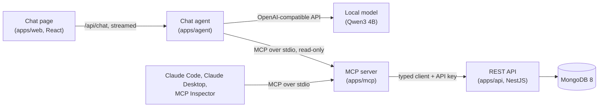

# Northwind MCP

The classic **Northwind Traders** database rebuilt as a modern REST/OpenAPI API on MongoDB +
NestJS, wrapped in an **MCP server** so AI assistants can work with it, and a chat page where a
**small local model** answers questions about the business through that server.



## What it shows

- **MCP server design** ([apps/mcp](apps/mcp/README.md)): 20 task-shaped tools instead of one
  per endpoint, a guide resource, 3 prompts with autocomplete, output schemas, and order writes
  behind one switch, with destructive tools marked and confirmed. Background and the design
  reasoning: [docs/mcp-primer.md](docs/mcp-primer.md).
- **Tools that small models can use:** lenient arguments behind strict, llama.cpp-safe schemas;
  references by code or name with close matches for typos; named periods instead of date
  arithmetic; results that carry the next step. Measured, not assumed:
  [docs/benchmark.md](docs/benchmark.md) takes a 4B model from 6.7 to about 7.5–8 of 9.
- **An API built for a model as the reader:** readable codes (`ALFKI`, `ORD-10248`), money as
  decimal strings, Problem Details errors with field paths, task-shaped analytics, and an
  OpenAPI spec with a contract test, from which the MCP server's client is generated.
- **A safe chat agent** ([apps/agent](apps/agent)): an MCP host with a streaming tool loop, the
  MCP server forced read-only, a strict Content Security Policy, and each answer showing the
  tool calls behind it.
- **Engineering around it:** a Turborepo monorepo (TypeScript, pnpm), Mongoose schemas with
  copied references, a seed that shifts the classic data to the present, over 400 unit and
  end-to-end tests (in-memory MongoDB, in-memory MCP clients, a scripted model), Docker images
  and Compose profiles, and a smoke test of the whole stack.

## Install the chat

For a machine that only needs to **run** the chat: everything builds and runs in Docker, and
setup needs nothing more than Node. Any OS with Docker works; the model server is your choice.

**1. Pick where the model runs.** Setup suggests one for your machine and asks.

| Your machine                                    | Model server                                                                | Speed                    |
| ----------------------------------------------- | --------------------------------------------------------------------------- | ------------------------ |
| A Mac with Apple silicon                        | [Docker Model Runner](#apple-silicon-with-docker-model-runner) (on the GPU) | fast                     |
| Linux, or Windows with WSL2, with an NVIDIA GPU | [Ollama](#ollama-any-os) with the GPU                                       | fast                     |
| Anything else with Docker                       | [Ollama](#ollama-any-os) on the CPU                                         | slow, but works anywhere |
| A model server you already have, or a cloud API | [OpenAI-compatible](#an-openai-compatible-server)                           | depends on the server    |

For a local model: 8 GB of memory at the least (16 GB is comfortable) and about 15 GB of free
disk for the images, the model and the data.

**2. Install Docker and Node.**

- **Docker:** Docker Desktop on macOS and Windows, Docker Desktop or Docker Engine on Linux
  (https://docs.docker.com/get-started/get-docker/). Compose 2.24 or later; it comes with both.
  On Windows, run everything inside WSL2.
- **Node 24** (https://nodejs.org/, or nvm). Setup is plain Node: no `pnpm install` needed.

**3. Get the project.**

```sh
git clone https://github.com/wbarahona/northwind-mcp.git northwind-chat
cd northwind-chat
```

**4. Check the machine, then set everything up.**

```sh
node scripts/stack/cli.mjs doctor   # ✓ fine · ! worth knowing · ✗ fix this first
node scripts/stack/cli.mjs setup    # 5–20 minutes the first time, mostly the model download
```

Setup writes `.env` with a new random API key and your choice of model server, prepares that
server, downloads the model (Qwen3 4B, about 2.5 GB) and the base images, builds the stack,
starts it, loads the Northwind data and prints the chat's address. Everything it downloads
stays on this machine. It is safe to run again: it keeps `.env` (adding only what is missing)
and never reloads a database that already has data. `--provider`, `--model` and `--yes` skip
the questions, `--dry-run` shows the steps without doing them, and `--help` lists the rest.

**5. Open the chat** at http://localhost:5173. The status should say "Model ready"; the first
answer takes longer while the model loads.

**Share it on your network.** Add `AGENT_BIND=0.0.0.0` to `.env`, then
`docker compose --profile stack up -d --wait`. Setup prints the addresses others can open
(on a Mac also its `.local` name). The firewall may ask whether to allow incoming
connections for Docker: allow it. **There is no login**: anyone on the network can ask
questions. The data is read-only, but share only on a network you trust.

**Day to day.**

| To                           | Run                                                                                                                                     |
| ---------------------------- | --------------------------------------------------------------------------------------------------------------------------------------- |
| Stop the chat (data stays)   | `docker compose --profile '*' down`                                                                                                     |
| Start it again               | `docker compose --profile stack up -d --wait`                                                                                           |
| See what the agent is doing  | `docker compose logs -f agent`                                                                                                          |
| Reset the Northwind data     | `docker compose run --rm seed`                                                                                                          |
| Update to the latest version | `git pull && node scripts/stack/cli.mjs setup`                                                                                          |
| Switch model servers         | `node scripts/stack/cli.mjs setup --provider …`                                                                                         |
| Remove everything            | `docker compose --profile '*' down -v` (deletes the data and Ollama's models); with Docker Model Runner, also `docker model rm <model>` |

**If something goes wrong.**

- **"Model server offline" in the chat:** the model server is off or still loading. The
  agent's log names it and its address (`docker compose logs agent`); `doctor` checks it.
- **A base image won't download (429 Too Many Requests):** Docker Hub limits downloads on some
  networks. Set `NODE_IMAGE` and `MONGO_IMAGE` (and `OLLAMA_IMAGE`) in `.env` to another
  registry (examples in `.env.example`) and run setup again.
- **"Port … is in use":** something else (often a developer's `pnpm dev`) holds 5173, 3000,
  27017 or 11434. Stop it, or move the stack with `AGENT_PORT` / `API_PORT` / `MONGO_PORT` /
  `OLLAMA_PORT` in `.env`.
- **Slow answers:** the first one loads the model (10–30 s). After that, expect a few seconds to
  half a minute per answer on a GPU, longer for questions that need several look-ups, and
  several times that on a CPU.

### Apple silicon with Docker Model Runner

The fastest option on a Mac: Docker Model Runner runs the model natively, outside Docker's
virtual machine, on the Metal GPU. Needs an M1 or later and Docker Desktop 4.40 or later
(it includes Model Runner). Setup turns Model Runner on, with access from the Mac on port
12434 for `pnpm dev` (a Docker Desktop setting), pulls the model and gives it a 16k context.
In the stack, `compose.model-runner.yml` asks Compose to make sure the model is there.

- **Give the model room (16 GB Macs).** Since the model runs outside the VM, the VM needs
  less: Docker Desktop → Settings → Resources → Memory, about 3 GB, then Apply & restart
  (`doctor` warns when it's set higher).
- **More accurate answers on 24 GB or more:** `--model hf.co/Qwen/Qwen3-8B-GGUF:Q4_K_M`
  (9 of 9 in the [benchmark](docs/benchmark.md), about 1.6× slower).
- Model Runner also works on Docker Desktop for Windows and Linux (NVIDIA GPUs, or the CPU);
  setup suggests Ollama there, but `--provider docker-model-runner` picks it.

### Ollama (any OS)

`compose.ollama.yml` adds an Ollama container to the stack, which pulls the model (default
`qwen3:4b`) on its first start and keeps it in the `ollama-models` volume. It runs on the CPU
anywhere; with an NVIDIA GPU, setup adds `compose.ollama-nvidia.yml`.

- **NVIDIA on Linux** needs the NVIDIA Container Toolkit (`doctor` checks); **on Windows**,
  Docker Desktop with WSL2 passes the GPU through.
- **On a Mac**, containers can't use the GPU, so Ollama is much slower than Docker Model Runner.
  In Docker Desktop the model lives inside the VM: give it about 8 GB (`doctor` warns).
- **More accurate answers on 24 GB or more:** `--model qwen3:8b`.
- `pnpm dev` can use the same container (`LLM_PROVIDER=ollama`; it listens on 127.0.0.1:11434).

### An OpenAI-compatible server

Any server with the OpenAI chat completions API: llama.cpp's `llama-server`, LM Studio, vLLM,
or a cloud API. The model has to support tool calls.

```sh
node scripts/stack/cli.mjs setup --provider openai-compatible \
  --url http://host.docker.internal:1234/v1/ --model <model name>
```

- `--url` (`STACK_LLM_URL` in `.env`) is the address **as the stack's container sees it**:
  `host.docker.internal` is this machine. `pnpm dev` uses `LLM_URL` instead (e.g.
  `http://localhost:1234/v1/`).
- A server that needs a key gets it from `LLM_API_KEY`.
- Questions and tool results go to that server: with a cloud API, they leave this machine.
- The agent adds model-specific handling for Qwen3 only (see `LLM_PROFILE` in `.env.example`);
  other models are used as they are. Check one with `pnpm chat:bench`.

## Requirements (development)

- Node 24 (`nvm use` — pinned in `.nvmrc`)
- pnpm via corepack (`corepack enable`; version pinned in `package.json`)
- Docker (Desktop, or Engine on Linux), running
- A model server for the chat (see [Install the chat](#install-the-chat)); the API and the MCP
  server don't need one

## Getting started

```sh
nvm use
corepack enable
pnpm install
cp .env.example .env
pnpm db:up          # MongoDB 8, single-node replica set on localhost:27017
pnpm seed           # load classic Northwind, dates shifted to the present (idempotent)
```

Connect with Compass or mongosh: `mongodb://localhost:27017/northwind?replicaSet=rs0`

## Using the API

```sh
pnpm dev            # http://localhost:3000
```

- **Docs:** http://localhost:3000/docs (Swagger UI; click _Authorize_ and enter a key from `API_KEYS`). The raw spec is at `/openapi.json` and is committed as [`apps/api/openapi.json`](apps/api/openapi.json).
- **Auth:** send `x-api-key` on every request except `/health`.

```sh
curl -H 'x-api-key: dev-key-change-me' localhost:3000/v1/customers/ALFKI
curl -H 'x-api-key: dev-key-change-me' 'localhost:3000/v1/orders?customerId=ALFKI&status=pending'
curl -H 'x-api-key: dev-key-change-me' 'localhost:3000/v1/analytics/top-customers?from=2026-07-01&to=2026-10-01&limit=5'
```

The conventions (ids and codes, money as decimal strings, pagination, Problem Details errors, date ranges) are described at the top of `/docs`.

## Run the whole stack in Docker

The API and the chat, built into images and run next to Mongo, with no Node needed on the
host for them. On a new machine, one command checks it, writes `.env` with a random API key and the model
server, prepares that server, downloads the model and images, builds, starts and seeds:
`pnpm stack:setup` (`--dry-run` shows the steps; `pnpm stack:doctor` only checks). It is
plain Node, safe to re-run, and works on macOS, Linux and Windows. Day to day:

```sh
pnpm stack:up       # builds the images, starts mongo + api + agent, waits until healthy
pnpm stack:seed     # first time (or to reset): load classic Northwind
curl -H 'x-api-key: dev-key-change-me' localhost:3000/v1/orders/ORD-10248
# the chat: http://localhost:5173
pnpm stack:down     # stop everything (the data stays in the Docker volume)
```

- The API container uses `API_KEYS` from `.env` (required) and listens on
  `127.0.0.1:3000`, like `pnpm dev`. So `.mcp.json`, Swagger and Compass work unchanged.
- **Run the stack or `pnpm dev`, not both**: they share ports 3000 and 5173 (starting the
  second one fails with "address already in use") and the same Mongo data. `API_PORT` and
  `AGENT_PORT` move the stack's ports if you need both.
- `pnpm stack:smoke` checks everything on a throwaway copy: its own Mongo, data and
  ports, removed afterwards. It covers health, auth, an order read, the MCP server placing
  and shipping an order through the container, and the chat agent (page, read-only tools,
  a clear error without a model).
- The model server comes from one more Compose file, chosen with `COMPOSE_FILE` in `.env`
  (setup writes it): `compose.model-runner.yml`, `compose.ollama.yml` (+
  `compose.ollama-nvidia.yml`), or none for an OpenAI-compatible server.
- Settings (`API_PORT`, `MONGO_PORT`, `MONGO_DB`, `NODE_IMAGE`, `MONGO_IMAGE` for other
  registries, the model settings) are listed in `.env.example`.

## The chat

Ask Northwind questions in plain language at **http://localhost:5173**. A model (Qwen3 4B
by default, on the model server you chose) picks the MCP tools; the agent (`apps/agent`) runs
them through the MCP server, **read-only**; each answer shows how it was found under
_How I got this_.

- **Development:** `pnpm dev` runs the agent on 5174 and the page on 5173 (Vite, hot
  reload), next to the API.
- **Docker:** `pnpm stack:up` runs it as the `agent` container on 5173.
- **The model** comes from `LLM_PROVIDER` in `.env`: `docker-model-runner` (the default;
  `localhost:12434` for `pnpm dev`), `ollama` (`localhost:11434`) or `openai-compatible`
  (`LLM_URL`). `LLM_MODEL` picks the model, with a 16k-token context. `pnpm stack:setup`
  prepares the server for both `pnpm dev` and the stack. Until it's reachable the page says
  "Model server offline", and the agent's log says where it looked.
- **Model-specific handling** lives in profiles (`apps/agent/src/profiles.ts`): `qwen3`
  turns off its slow thinking phase and runs tool calls it writes as text; any other model gets
  `generic`. The profile is picked from the model's name, or set with `LLM_PROFILE`.
- **How good is it?** Qwen3 4B answers about 7.5–8 of 9 benchmark questions right (8B: 9 of 9).
  Results, charts and how they were improved: [docs/benchmark.md](docs/benchmark.md); rerun
  with `pnpm chat:bench`.
- **Sharing on the local network:** set `AGENT_BIND=0.0.0.0` in `.env` and run
  `pnpm stack:up`; others open this machine's address on port 5173. Anyone on the network can
  then ask questions. The data is read-only, but **there is no login**, so do this only on
  a network you trust.

## Using the MCP server

`apps/mcp` exposes the API to AI assistants as 20 tools, a guide resource and 3 prompts. With
the API running and `pnpm build` done, start `claude` from the repo root and approve the
`northwind` server ([`.mcp.json`](.mcp.json) reads `NORTHWIND_API_KEY` from your environment
or `.env`). Writes to orders are on by default; see
[What the assistant can change](apps/mcp/README.md#what-the-assistant-can-change) and how to
turn them off. Setup for Claude Desktop and the Inspector: [apps/mcp/README.md](apps/mcp/README.md).

## Scripts

| Script                                               | What it does                                                                                                                              |
| ---------------------------------------------------- | ----------------------------------------------------------------------------------------------------------------------------------------- |
| `pnpm dev` / `build` / `lint` / `typecheck` / `test` | Run the task across all workspaces (Turborepo)                                                                                            |
| `pnpm format` / `format:check`                       | Prettier                                                                                                                                  |
| `pnpm db:up` / `db:down`                             | Start / stop MongoDB (data is kept in a Docker volume)                                                                                    |
| `pnpm seed`                                          | Reset and load the Northwind data. `SEED_ANCHOR_DATE=YYYY-MM-DD` fixes the date shift; `-- --yes` is required for a non-local `MONGO_URI` |
| `pnpm test:e2e`                                      | End-to-end tests against an in-memory MongoDB (no Docker needed)                                                                          |
| `pnpm openapi` / `openapi:check`                     | Regenerate `apps/api/openapi.json` / fail if it is out of date (no database needed)                                                       |
| `pnpm db:logs` / `db:shell`                          | Tail Mongo logs / open mongosh                                                                                                            |
| `pnpm stack:doctor` / `stack:setup`                  | Check this machine / set everything up from scratch (`node scripts/stack/cli.mjs doctor` / `setup`; safe to re-run)                       |
| `pnpm stack:up` / `stack:down`                       | Start the Docker stack (mongo, api, agent and the model server, built from source) / stop it                                              |
| `pnpm stack:seed`                                    | Reset and load the Northwind data from inside the stack                                                                                   |
| `pnpm stack:logs`                                    | Follow the API container's logs                                                                                                           |
| `pnpm stack:smoke`                                   | Smoke-test the whole stack on a throwaway copy (own Mongo and ports, removed afterwards)                                                  |
| `pnpm stack:test`                                    | Unit tests for the setup tool (`scripts/stack`)                                                                                           |
| `pnpm chat:bench`                                    | Score the chat on the nine benchmark questions ([docs/benchmark.md](docs/benchmark.md))                                                   |

## Layout

```
apps/       api (NestJS), mcp (MCP server), agent (chat agent), web (React chat page)
packages/   db (schemas, shared by api + seed), seed, api-client (typed client), e2e-stack (test helper), tsconfig, eslint-config
```

## License

[MIT](LICENSE). The Northwind data comes from Microsoft's
[sql-server-samples](https://github.com/microsoft/sql-server-samples) (MIT); its license is in
[packages/seed/data/raw](packages/seed/data/raw).
