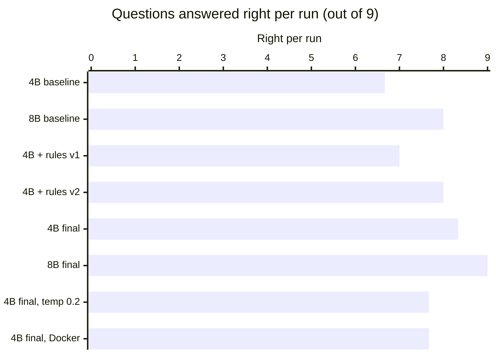
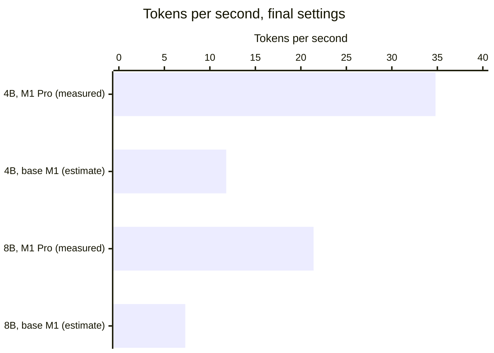

# Chat benchmark: a 4B model at about 7.5–8 of 9

How well a small local model answers questions about Northwind through the chat agent and the
MCP server, and which changes moved the score. Measured with `pnpm chat:bench` on 2026-10-24.

**The result:** Qwen3 4B, a 2.5 GB model running on a laptop, answers **about 7.5–8 of 9**
questions right (7.7 on average over six runs of the final settings, from 7.0 to 8.33), up
from **6.7** at the baseline. Qwen3
8B goes from **8 to 9 of 9**. The gains came from the tool design and the instructions, not
from a bigger model.

## How it was measured

- **Questions:** nine, of three kinds: one-tool look-ups, filters and reports, and questions
  that need several steps. They are listed below with the expected answers.
- **Path:** `POST /api/chat` on the chat agent, which runs the Northwind MCP server read-only,
  against freshly seeded data.
- **Repeats:** every question is asked **3 times** per configuration, because a model's answers
  vary; scores are averages per run.
- **Scoring:** automatic, from key facts computed from the raw Northwind data rather than from
  the API (names, codes, amounts; case-, accent- and separator-insensitive). A known wrong
  figure counts against an answer. Right = every fact present; partly right = at least half.
- **Hardware:** Apple M1 Pro, 16 GB; Docker Model Runner (llama.cpp on the Metal GPU); 4-bit
  GGUF models; 16k-token context.

## Every change, measured



| Configuration                       | Model    | Right per run | Partly right | s per answer | Tokens/s | Tool calls | Kept?      |
| ----------------------------------- | -------- | ------------- | ------------ | ------------ | -------- | ---------- | ---------- |
| Baseline                            | Qwen3 4B | 6.67          | 1.33         | 9.7          | 33.0     | 1.15       | yes        |
| Baseline                            | Qwen3 8B | 8.00          | 0            | 10.6         | 21.3     | 1.11       | yes        |
| Prompt rules, first wording         | Qwen3 4B | 7.00          | 1.33         | 14.1         | 34.5     | 1.15       | superseded |
| Rules reworded                      | Qwen3 4B | 8.00          | 0.33         | 13.1         | 34.9     | 1.30       | superseded |
| Rules + concrete next step (final)  | Qwen3 4B | **8.33**      | 0            | 10.2         | 34.8     | 1.22       | **yes**    |
| Rules + concrete next step (final)  | Qwen3 8B | **9.00**      | 0            | 12.6         | 21.4     | 1.11       | **yes**    |
| Final, temperature 0.2              | Qwen3 4B | 7.67          | 0.67         | 12.3         | 35.0     | 1.26       | no         |
| Final, in Docker (confirmation run) | Qwen3 4B | 7.67          | 0.67         | 12.4         | 33.1     | 1.26       | (check)    |

What each change was:

1. **Prompt rules, first wording:** four rules, each aimed at a mistake the baseline made: copy
   codes, names and figures exactly; pass a named customer, product or employee as a filter;
   retry with a code the tool suggests; list an order's products when asked what was ordered.
   The retry rule fixed "ALKFI"-style typos at once, but "list the products" made 4B drop the
   order total.
2. **Rules reworded:** the filter rule made concrete ("for one customer's orders, set
   `customer`: without it you get every customer's orders") and the order rule naming code,
   products _and_ total. A general instruction did nothing for 4B; the concrete one fixed it.
3. **A concrete next step in the tool:** `find_orders` now says "to see them, call get_order
   with an order code (e.g. ORD-11011)" instead of a general hint. This lives in the MCP
   server, so it helps every host, not only the chat agent.
4. **Temperature 0.2:** no better than the server's default, so it stays unset (the
   `LLM_TEMPERATURE` setting remains).
5. **Confirmation run in Docker**, with the images the stack ships: **7.67**. The difference
   from 8.33 is run-to-run variation, measured below. Its misses are concentrated in question
   7 (an order's products) and question 2 (the shortfall).

A bug fix also counts here: Qwen3 sometimes writes a follow-up tool call as text in its own
`<tool_call>` format, which llama.cpp passed on as _reasoning_. The agent saw no call and no
answer and reported an empty answer; it now runs such calls. That is why 8B's question 7 went
from failing empty to finding the right order.

## How much the same settings vary

The model server samples with its default temperature, so the same input gives different
answers from run to run. Four more runs of the final settings, a day later, show how much:

| Run                                             | Right per run |
| ----------------------------------------------- | ------------- |
| Final, in Docker                                | 7.0           |
| Final, in Docker, again                         | 7.33          |
| Final, development (the code of the runs above) | 8.33          |
| Final, development, after a refactor            | 7.33          |

The refactor (configurable model servers) left every request to the model byte-identical,
checked by recording both versions' requests, including tool results, against a fake model
server. So the spread, 7.0 to 8.33 with three runs per question, is the model's alone. Six
runs of the final settings average **7.7**, hence "about 7.5–8". The slips are the ones the
baseline made: a shortfall of 5 given as 15 (question 2), a missing phone number or total, and
question 7.

## Question by question, before and after

Runs right out of 3 (✓ right, ◐ partly right, ✕ wrong).

| Question                                                         | 4B before | 4B after | 8B before | 8B after |
| ---------------------------------------------------------------- | --------- | -------- | --------- | -------- |
| What's in order 10248?                                           | ✓✓✓ 3     | ✓✓✓ 3    | ✓✓✓ 3     | ✓✓✓ 3    |
| Which products are low on stock?                                 | ✓✓◐ 2     | ✓✓✓ 3    | ✓✓✓ 3     | ✓✓✓ 3    |
| Show me the contact for customer ALFKI                           | ✓◐◐ 1     | ✓✓✓ 3    | ✓✓✓ 3     | ✓✓✓ 3    |
| Who were the top 5 customers last year?                          | ✓✓✓ 3     | ✓✓✓ 3    | ✓✓✓ 3     | ✓✓✓ 3    |
| List the customers in Germany                                    | ✓✓◐ 2     | ✓✓✓ 3    | ✓✓✓ 3     | ✓✓✓ 3    |
| How much does Chai cost and how many are in stock?               | ✓✓✓ 3     | ✓✓✓ 3    | ✓✓✓ 3     | ✓✓✓ 3    |
| What did Alfreds Futterkiste order most recently?                | ✕✕✕ 0     | ✓✕✕ 1    | ✕✕✕ 0     | ✓✓✓ 3    |
| Which supplier makes the products that are low on stock?         | ✓✓✓ 3     | ✓✓✓ 3    | ✓✓✓ 3     | ✓✓✓ 3    |
| Which employee sold the most this year, and what is their title? | ✓✓✓ 3     | ✓✓✓ 3    | ✓✓✓ 3     | ✓✓✓ 3    |

Where 4B went wrong at the baseline: it typed ALFKI as "ALKI" and gave up on the phone and
email; it miscopied "Königlich Essen"; it gave a shortfall of 5 as 15; and twice it left out
the customer filter and reported another customer's order as Alfreds'.

## The expected answers

Computed from `packages/seed/data/raw` (exact decimals, each line rounded half-up to the cent).
They assume the seed's date shift of 10388 days (`pnpm seed` prints it) and a run in Q4 2026;
with another shift, the dates move and the "last year / this year" figures change.

| #   | Question                                                         | Expected                                                                                                                                                                                                                        |
| --- | ---------------------------------------------------------------- | ------------------------------------------------------------------------------------------------------------------------------------------------------------------------------------------------------------------------------- |
| 1   | What's in order 10248?                                           | Queso Cabrales 12 × 14.00, Singaporean Hokkien Fried Mee 10 × 9.80, Mozzarella di Giovanni 5 × 34.80; net 440.00, total 472.38                                                                                                  |
| 2   | Which products are low on stock?                                 | Nord-Ost Matjeshering (PRD-030) and Outback Lager (PRD-070), each 5 short of the reorder level                                                                                                                                  |
| 3   | Show me the contact for customer ALFKI                           | Maria Anders, Sales Representative, +49300074321, maria.anders@alfreds-futterkiste.example                                                                                                                                      |
| 4   | Who were the top 5 customers last year?                          | 2025: QUICK-Stop 45,904.82, Ernst Handel 36,238.15, Save-a-lot Markets 32,891.25, Rattlesnake Canyon Grocery 28,768.53, Mère Paillarde 24,276.20                                                                                |
| 5   | List the customers in Germany                                    | 11: Alfreds Futterkiste, Blauer See Delikatessen, Die Wandernde Kuh, Drachenblut Delikatessen, Frankenversand, Königlich Essen, Lehmanns Marktstand, Morgenstern Gesundkost, Ottilies Käseladen, QUICK-Stop, Toms Spezialitäten |
| 6   | How much does Chai cost and how many are in stock?               | 18.00 per 10 boxes x 20 bags; 39 in stock                                                                                                                                                                                       |
| 7   | What did Alfreds Futterkiste order most recently?                | ORD-11011 on 2026-09-17: Escargots de Bourgogne 40, Flotemysost 20                                                                                                                                                              |
| 8   | Which supplier makes the products that are low on stock?         | Nord-Ost-Fisch Handelsgesellschaft mbH (Sven Petersen) for PRD-030; Pavlova, Ltd. (Ian Devling, Marketing Manager) for PRD-070                                                                                                  |
| 9   | Which employee sold the most this year, and what is their title? | Janet Leverling, Sales Representative, 120,811.95 in 2026                                                                                                                                                                       |

## Speed: why 4B is the default



Generation speed follows memory bandwidth, and laptops differ a lot in it: a base M1 has about
a third of an M1 Pro's (68 against 200 GB/s). The estimate scales the measurement by 68/200.
The rule agreed before measuring: 8B becomes the default only if it gets at least one more
question right on average. On the runs at the time it was 0.7 ahead, so **Qwen3 4B is the
default**, and 8B is the option for machines with 24 GB or more. Against 4B's later average
(7.7) the gap is 1.3, but 8B has only one run of the final settings, so the choice stands until
8B has repeat runs too.

## Running it yourself

```sh
pnpm dev                     # or the Docker stack; the agent must be running
pnpm chat:bench              # the dev agent on 127.0.0.1:5174, 3 runs per question
pnpm chat:bench --url http://127.0.0.1:5173 --runs 5 --label my-change
```

Full answers are written to `bench-results/` (not committed).
